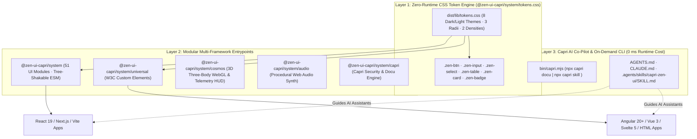

# `@zen-ui-capri/system` (`zeN-UI // CAPRI`) — `v1.1.8`

Universal, zero-dependency, multi-framework design system and component library (`320px` mobile to `4K` ultrawide) for **React 19**, **Angular 20+**, **Vue 3**, **Svelte 5**, and **Vanilla HTML/CSS**, paired with the **Capri 5-Subroutine AI Co-Pilot & Security Guard CLI** in a single versioned npm package (`0` runtime dependencies).

```bash
npm install @zen-ui-capri/system
```

- **Full Architecture & User-Flow Dossier:** [`docs/CAPRI-ARCHITECTURE-DOSSIER.md`](./docs/CAPRI-ARCHITECTURE-DOSSIER.md)
- **AI Agent Subroutine Protocol (`Claude` / `Codex` / `Gemini`):** [`AGENTS.md`](./AGENTS.md) & [`.agents/skills/capri-zen-ui/SKILL.md`](./.agents/skills/capri-zen-ui/SKILL.md)

---

## 1. System Architecture & Subpath Exports



---

## 2. Core Capabilities

1. **51 Selectable Modules & Primitives (`@zen-ui-capri/system`):**
   - **Actions & Icons (5):** `ZenButton`, `ZenCopyButton`, `ZenIconButton`, `ZenIcon` (`40` typed vector glyphs), `ZenSegmentedControl`.
   - **Forms & Inputs (10):** `ZenInput`, `ZenTextarea`, `ZenDropdown` (`onMouseDown` zero blur-race commit), `ZenNumberStepper` (IEEE-754 precision), `ZenSwitch`, `ZenCheckbox`, `ZenRadioGroup`, `ZenSlider`, `ZenChipFilter`, `ZenFileUpload`.
   - **Navigation & Wayfinding (6):** `ZenNavbar` (responsive desktop + mobile drawer), `ZenTabs`, `ZenBreadcrumbs`, `ZenPagination`, `ZenStepper`, `ZenSidebar`.
   - **Surfaces & Overlays (10):** `ZenCard`, `ZenHeading`, `ZenModal` (focus-trapped), `ZenDrawer`, `ZenCommandPalette` (`Ctrl+K`), `ZenAccordion`, `ZenTooltip`, `ZenDivider`, `ZenArchitectureNote`, `ZenCheckList`.
   - **Data & Telemetry (10):** `ZenDataTable` (generic `<T>` sortable), `ZenKpiCard`, `ZenSparkline`, `ZenMetricStrip`, `ZenProgressBar`, `ZenCircularGauge`, `ZenAvatar`, `ZenCodeBlock`, `ZenDossierPanel`, `ZenTimelineCard`.
   - **Feedback & Subpath Modules (10):** `ZenBadge`, `ZenTagList`, `ZenKbd`, `ZenAlert`, `ZenSkeleton`, `ZenEmptyState`, `ZenAIConstruct`, `ZenAmbientBackground`, `ZenAudioController` (`/audio`), `CapriEngine` (`/capri`).
2. **8 Dark & Light Polarity Themes (`ZenThemeProvider` / `zenTheme`):**
   - **4 Dark Themes:** `blackwall-crimson` (*Capri // Capricorn*), `obsidian-gold`, `neon-emerald`, `midnight-cobalt`.
   - **4 Light Themes:** `atelier-paper`, `nordic-snow`, `kyoto-matcha`, `cyber-daylight`.
   - **Geometry & Density Controls:** `data-radius="sharp" | "architectural" | "soft"` and `data-density="comfortable" | "compact"`.
3. **Isolated Showcase Workbench (`src/site/` -> `dist/site/`):**
   - The interactive 51-module Storybook & Workbench lives in `src/site/` and builds exclusively to `dist/site/`, completely isolated from the published `dist/lib/` npm package bundles.

---

## 3. Capri AI Subroutines (Voice Disabled by Default · Opt-In via `--voice`)

Talk to **Capri** in **Claude Code, OpenAI Codex, Gemini, or Cursor**, or run `npx capri` in the terminal:

| Subroutine Command | Opt-In Voice Command | Purpose & Enforced Ruleset |
| :--- | :--- | :--- |
| **`"Capri guard"`** | `"Capri guard --voice"` | **Security, Anti-Prompt-Injection & WCAG Guard:** Blocks prompt-injection payloads (`capri.scanPromptInjection()`, `capri.sanitizeForPrompt()`), prevents DOM XSS (`escapeZenHtml`) & secret leaks, enforces `onMouseDown` dropdown selection, explicit `ariaLabel`, and `0px` horizontal overflow (`320px` to `4K`). |
| **`"Capri orion"`** | `"Capri orion --voice"` | **UI Synthesis:** Builds screens using the 51 `@zen-ui-capri/system` primitives and 40 `<ZenIcon>` glyphs (never rendering `<ZenAIConstruct />` in business apps). |
| **`"Capri architect"`** | `"Capri architect --voice"` | **Multi-Stack & Token Governance:** Enforces zero `any`, `readonly T[]` arrays, zero hardcoded hex colors (`--zen-*` tokens), and Angular 20+ / Vue / React interop. |
| **`"Capri zen"`** | `"Capri zen --voice"` | **Theme Polarity & 60fps Motion:** Verifies contrast across all 8 dark/light themes, `--zen-ease-spring` (`0.97x`) tactile press physics, and `prefers-reduced-motion` collapse. |
| **`"Capri docu"`** | `"Capri docu --voice"` | **Automated Documentation:** Generates architecture dossiers, component inventories, user flows, and Mermaid `flowchart TD` diagrams (`npx capri docu`). |

---

## 4. Commands & Verification

```bash
npm run dev                        # Start local showcase workbench (port 5180)
npm run build:lib                  # Build clean NPM package into dist/lib/ (ESM + .d.ts + tokens.css)
npm run build:site                 # Build isolated showcase website into dist/site/
npm run test:e2e                   # Run Playwright multi-viewport & Storybook E2E verification
npx capri docu                     # Generate static architecture & user-flow Markdown dossier (0 ms build cost)
npx capri skill guard              # Print guard subroutine ruleset (Voice OFF by default; add --voice to enable)
```
