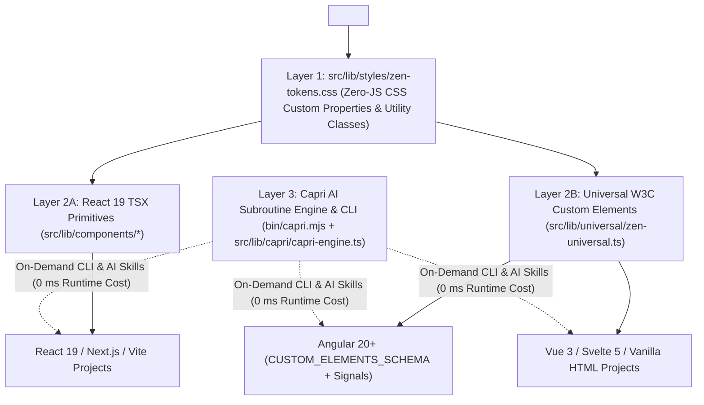
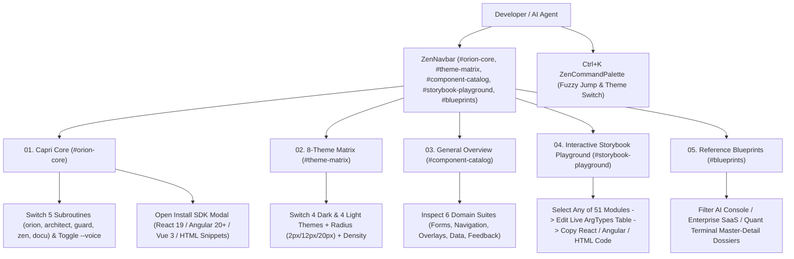

# `@zen-ui-capri/system` — CAPRI Automated Architecture, User-Flow & AI Context Dossier

- **Subroutine:** `CAPRI // AUTO-DOCU` (`docu`) — Persona Voice: `OFF (Default)`
- **Package:** `@zen-ui-capri/system` v1.1.8 (`https://github.com/lukaspabst/zeN-UI`)
- **Total Source Modules Scanned:** 36 files (`32` core library modules in `src/lib/`, `24` UI component modules, `132` exported public symbols & types)
- **Verification Status:** `tsc --noEmit && vite build` (`0` errors) · Playwright E2E (`3/3` passed across `375x812` Mobile, `768x1024` Tablet, `1440x900` Desktop, `2560x1440` Ultrawide) · `capri.guard()` DOM Audit Score: **`100/100` (`0px` overflow)**

---

## 1. Three-Layer Multi-Stack Architecture

`@zen-ui-capri/system` is engineered so any frontend stack can consume the exact same design tokens, icons, and accessibility contracts without visual drift or runtime bloat:

### Package Entry Points (`package.json`)
| Import Path | Target Stack | Exports & Responsibility |
| :--- | :--- | :--- |
| **`@zen-ui-capri/system/tokens.css`** | All Stacks | 8 Dark/Light themes, 3 corner radii (`2px`, `12px`, `20px`), 2 densities (`comfortable`, `compact`), and zero-Tailwind semantic classes (`.zen-btn`, `.zen-input`, `.zen-select`, `.zen-table`, `.zen-card`, `.zen-badge`). |
| **`@zen-ui-capri/system`** | React 19 | All 51 typed React primitives, `ZenThemeProvider`, `useZenTheme`, `ZenIcon` (40 glyphs), `useZenToast`, `useZenAudioSynth`, and headless `capri` engine. |
| **`@zen-ui-capri/system/universal`** | Angular 20+, Vue 3, Svelte 5, HTML | Framework-agnostic `zenTheme` (`ZenThemeController`), `zenAudio`, `capri`, and `registerZenElements()` defining `<zen-icon>`, `<zen-theme-switcher>`, `<zen-ambient-background>`, and `<zen-ai-construct>`. |
| **`npx capri`** (`bin/capri.mjs`) | CLI / Claude / Codex / Gemini | On-demand static architecture scanner (`npx capri docu`) and subroutine ruleset printer (`npx capri skill <guard\|orion\|architect\|zen\|docu> [--voice]`). |

---

## 2. Interactive User-Flow Topology (`src/App.tsx` & `ZenStorybookPlayground.tsx`)

---

## 3. Complete 51-Module Component & File Inventory

| Suite | Module Name | Source File | W3C Custom Element / CSS Selector | Key Accessibility & Engineering Contract |
| :--- | :--- | :--- | :--- | :--- |
| **Actions & Icons (5)** | `ZenButton` | `src/lib/components/ZenButton.tsx` | `button.zen-btn-base` | Native `<button type="button">`, `aria-pressed`, `0.97x` spring press, loading lock |
| | `ZenCopyButton` | `src/lib/components/ZenButton.tsx` | `zen-copy-button` | Clipboard write with 2000ms confirmation state |
| | `ZenIconButton` | `src/lib/components/ZenNavigation.tsx` | `button.zen-icon-btn` | Mandatory `ariaLabel` prop mapped to `aria-label` |
| | `ZenIcon` | `src/lib/components/ZenIcon.tsx` | `<zen-icon>` | 40 typed vector glyphs (`ZenIconName`), 5 sizes, 8 semantic theme tones |
| | `ZenSegmentedControl` | `src/lib/components/ZenSegmentedControl.tsx` | `zen-segmented-control` | `role="radiogroup"`, roving `tabIndex`, `ArrowLeft`/`ArrowRight`/`Home`/`End` |
| **Forms & Inputs (10)** | `ZenInput` | `src/lib/components/ZenInput.tsx` | `input.zen-input` | Linked `<label htmlFor>`, `aria-invalid`, `aria-describedby` |
| | `ZenTextarea` | `src/lib/components/ZenForms.tsx` | `textarea.zen-textarea` | Multi-line input with live character quota counter |
| | `ZenDropdown` | `src/lib/components/ZenDropdown.tsx` | `select.zen-select` | `onMouseDown` option commit to prevent input blur race conditions |
| | `ZenNumberStepper` | `src/lib/components/ZenForms.tsx` | `zen-number-stepper` | IEEE-754 floating-point safe increment/decrement with `min`/`max` clamping |
| | `ZenSwitch` | `src/lib/components/ZenSwitch.tsx` | `button[role="switch"]` | `role="switch"`, `aria-checked`, `aria-labelledby` linked to label ID |
| | `ZenCheckbox` | `src/lib/components/ZenForms.tsx` | `input[type="checkbox"]` | Supports `checked` and `indeterminate` (`aria-checked="mixed"`) |
| | `ZenRadioGroup` | `src/lib/components/ZenForms.tsx` | `div[role="radiogroup"]` | Card radio group with description and badge slots |
| | `ZenSlider` | `src/lib/components/ZenForms.tsx` | `input[type="range"]` | Native range input with custom accent fill track |
| | `ZenChipFilter` | `src/lib/components/ZenForms.tsx` | `zen-chip-filter` | Multi-select toggle chips with `aria-pressed` |
| | `ZenFileUpload` | `src/lib/components/ZenForms.tsx` | `zen-file-upload` | Keyboard-accessible dropzone + labeled `<input type="file">` |
| **Navigation (6)** | `ZenNavbar` | `src/lib/components/ZenNavbar.tsx` | `header.zen-navbar` | Sticky frosted header + responsive `<640px` mobile navigation drawer |
| | `ZenTabs` | `src/lib/components/ZenTabs.tsx` | `div[role="tablist"]` | Roving `tabIndex` tab bar with badge counters |
| | `ZenBreadcrumbs` | `src/lib/components/ZenNavigation.tsx` | `nav[aria-label="Breadcrumb"]` | Semantic breadcrumb trail with `aria-current="page"` |
| | `ZenPagination` | `src/lib/components/ZenNavigation.tsx` | `nav[aria-label="Pagination"]` | Tabular-nums page buttons with Previous/Next triggers |
| | `ZenStepper` | `src/lib/components/ZenNavigation.tsx` | `zen-stepper` | Multi-step workflow progress indicator |
| | `ZenSidebar` | `src/lib/components/ZenNavigation.tsx` | `aside.zen-sidebar` | Vertical navigation rail with active indicator and badges |
| **Surfaces & Overlays (10)** | `ZenCard` | `src/lib/components/ZenCard.tsx` | `.zen-card` | `static`, `interactive`, and `selected` optical glass surface states |
| | `ZenHeading` | `src/lib/components/ZenHeading.tsx` | `zen-heading` | Display heading with eyebrow, serif italic accent, and subtitle |
| | `ZenModal` | `src/lib/components/ZenModal.tsx` | `div[role="dialog"]` | `aria-modal="true"`, Escape dismissal, backdrop click, focus lock |
| | `ZenDrawer` | `src/lib/components/ZenOverlays.tsx` | `div[role="dialog"]` | Right-hand slide-over inspector drawer |
| | `ZenCommandPalette` | `src/lib/components/ZenOverlays.tsx` | `zen-command-palette` | Global `Ctrl+K` fuzzy command launcher with `onMouseDown` selection |
| | `ZenAccordion` | `src/lib/components/ZenOverlays.tsx` | `zen-accordion` | Collapsible disclosure panels with `aria-expanded` |
| | `ZenTooltip` | `src/lib/components/ZenOverlays.tsx` | `zen-tooltip` | Hover and keyboard-focus contextual hint popover |
| | `ZenDivider` | `src/lib/components/ZenOverlays.tsx` | `zen-divider` | Hairline divider with optional centered telemetry label |
| | `ZenArchitectureNote` | `src/lib/components/ZenCard.tsx` | `zen-architecture-note` | Highlighted architectural callout container |
| | `ZenCheckList` | `src/lib/components/ZenCard.tsx` | `zen-check-list` | Verification checklist with accent check glyphs |
| **Data & Telemetry (10)** | `ZenDataTable<T>` | `src/lib/components/ZenDataTable.tsx` | `.zen-table-wrapper > table.zen-table` | Generic `<T>` sortable data table with `aria-sort` and mobile scroll wrapper |
| | `ZenKpiCard` | `src/lib/components/ZenDataDisplay.tsx` | `zen-kpi-card` | Metric card with trend delta badge and embedded `ZenSparkline` |
| | `ZenSparkline` | `src/lib/components/ZenDataDisplay.tsx` | `zen-sparkline` | Zero-dependency SVG area/line sparkline with unique `useId()` gradient |
| | `ZenMetricStrip` | `src/lib/components/ZenCard.tsx` | `zen-metric-strip` | 2/3/4-column responsive KPI strip |
| | `ZenProgressBar` | `src/lib/components/ZenDataDisplay.tsx` | `div[role="progressbar"]` | Linear progress bar with `aria-valuenow`/`aria-valuemax` |
| | `ZenCircularGauge` | `src/lib/components/ZenDataDisplay.tsx` | `div[role="meter"]` | Radial SVG ring gauge with percentage readout |
| | `ZenAvatar` | `src/lib/components/ZenDataDisplay.tsx` | `zen-avatar` | Operator initials avatar with online/busy/offline presence dot |
| | `ZenCodeBlock` | `src/lib/components/ZenDataDisplay.tsx` | `zen-code-block` | Monospace code viewer with integrated `ZenCopyButton` |
| | `ZenDossierPanel` | `src/lib/components/ZenDossierPanel.tsx` | `zen-dossier-panel` | Master-detail architecture blueprint specification panel |
| | `ZenTimelineCard` | `src/lib/components/ZenTimelineCard.tsx` | `zen-timeline-card` | Chronological milestone card with tags and bullet points |
| **Feedback & AI Core (10)** | `ZenBadge` | `src/lib/components/ZenBadge.tsx` | `span.zen-badge` | 6 semantic tones (`gold`, `amber`, `emerald`, `coral`, `cyan`, `neutral`) + pulse dot |
| | `ZenTagList` | `src/lib/components/ZenBadge.tsx` | `zen-tag-list` | Flex-wrapped monospace metadata tag pills |
| | `ZenKbd` | `src/lib/components/ZenBadge.tsx` | `kbd.zen-kbd` | Hardware keycap shortcut indicator |
| | `ZenAlert` | `src/lib/components/ZenFeedback.tsx` | `div.zen-alert` | `info`, `success`, `warning`, `danger` banners with optional `actionSlot` |
| | `ZenSkeleton` | `src/lib/components/ZenFeedback.tsx` | `zen-skeleton` | `aria-busy="true"` shimmer placeholder rows |
| | `ZenEmptyState` | `src/lib/components/ZenFeedback.tsx` | `zen-empty-state` | Zero-data recovery state with icon and action slot |
| | `ZenAIConstruct` | `src/lib/components/ZenAIConstruct.tsx` | `<zen-ai-construct>` | Showcase Capri co-pilot (tree-shaken in production business apps) |
| | `ZenAmbientBackground` | `src/lib/components/ZenAmbientBackground.tsx` | `<zen-ambient-background>` | 4 atmospheric canvas modes (`blackwall-lattice`, `aurora-mesh`, `swiss-blueprint`, `minimal-void`) |
| | `ZenAudioController` | `src/lib/audio/ZenAudioController.tsx` | `zen-audio-controller` | Web Audio API procedural synthesizer (`pill` & `deck` modes) |
| | `CapriEngine` (`capri`) | `src/lib/capri/capri-engine.ts` | `capri` (Headless Singleton) | On-demand DOM/WCAG auditor (`capri.guard()`), docu generator (`capri.docu()`), and 5-subroutine AI skill provider |
