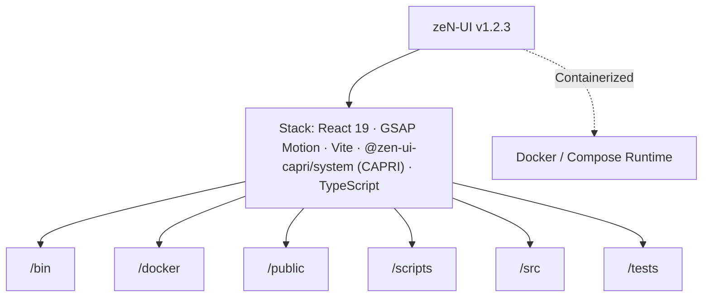

# zeN-UI // CAPRI Architecture & AI Context Dossier
> **Executive Summary:** zeN-UI // CAPRI — Universal Multi-Framework Design System (51 Primitives, 40 Vector Icons, 8 Dark/Light Themes & Capri 5-Subroutine AI Co-Pilot)
>
> *Generated automatically via `npx capri docu` (Zero build or browser runtime overhead)*

## 1. Project Identity & Stack Overview
- **Repository:** `zeN-UI` (`@zen-ui-capri/system`)
- **Version:** `1.2.3`
- **Detected Stack:** React 19 · GSAP Motion · Vite · @zen-ui-capri/system (CAPRI) · TypeScript · Docker Containerized
- **Top-Level Subsystems:** `/bin`, `/docker`, `/public`, `/scripts`, `/src`, `/tests`
- **Container Readiness:** `docker-compose.yml` present

## 2. Codebase Metrics & Language Breakdown
- **Total Source Files Scanned:** 63
- **Total Lines of Code (LOC):** 15,006
- **File Extensions:** `.tsx` (34), `.ts` (19), `.mjs` (5), `.css` (4), `.html` (1)
- **Key Domain Symbols / Classes / Functions (45):** `runOrionAudit`, `ZEN_ICON_SVG_INNER`, `runArchitectAudit`, `runGuardAudit`, `runZenAudit`, `analyzeRepo`, `generateStaticDocu`, `SUBROUTINES`, `CLI_THREAT_RULES`, `scanTextForPromptInjection`, `scanDirectory`, `readSafe`, `printHeader`, `runWorkspaceSync`, `runNpmRelease`, `ZenSynthPresetId`, `ZenSynthPreset`, `ZEN_SYNTH_PRESETS`, `UseZenAudioSynthOptions`, `ZenAudioSynthController`, `useZenAudioSynth`, `ZenAudioController`, `ZenAudioControllerProps`, `CapriEngine`, `capri`, `CAPRI_SUBROUTINE_SKILLS`, `PROMPT_THREAT_RULES`, `CapriSubroutineId`, `CapriAuditViolationCode`, `CapriAuditViolation`, `CapriThreatCategory`, `CapriPromptInjectionThreat`

## 4. Architecture & Subsystem Topology (`flowchart TD`)

## 5. Key Domain Modules & Entrypoints Inventory
| Module Path | Lines | Extension |
| :--- | ---: | :--- |
| `src/site/App.tsx` | 675 | `.tsx` |
| `src/lib/components/ZenForms.tsx` | 665 | `.tsx` |
| `src/site/components/storybook/StorybookStageInteractive.tsx` | 648 | `.tsx` |
| `src/lib/capri/capri-engine.ts` | 634 | `.ts` |
| `src/lib/components/ZenAIConstruct.tsx` | 595 | `.tsx` |
| `src/site/components/storybook/storybookCatalogCore.ts` | 569 | `.ts` |
| `src/lib/universal/zen-universal-elements.ts` | 537 | `.ts` |
| `src/site/sections/ComponentWorkbenchSection.tsx` | 537 | `.tsx` |
| `src/site/components/ZenStorybookPlayground.tsx` | 504 | `.tsx` |
| `bin/lib/capri-docu.mjs` | 482 | `.mjs` |
| `src/site/sections/WorkbenchOverlaysAndData.tsx` | 430 | `.tsx` |
| `src/site/components/storybook/StorybookStageTelemetry.tsx` | 401 | `.tsx` |

## 7. Available Build & Automation Scripts
- `npm run dev`: `vite --port 5180`
- `npm run build`: `tsc --noEmit && npm run build:lib && npm run build:site`
- `npm run build:site`: `vite build`
- `npm run build:lib`: `vite build --config vite.lib.config.ts && tsc -p tsconfig.lib.json`
- `npm run typecheck`: `tsc --noEmit`
- `npm run preview`: `vite preview --port 5180`
- `npm run test:e2e`: `playwright test`
- `npm run capri`: `node bin/capri.mjs`
- `npm run prepublishOnly`: `npm run capri -- all && npm run build:lib`
- `npm run publish:npm`: `node scripts/maintainer.mjs publish-npm`

## 8. Capri AI Agent Protocol (Claude / Codex / Gemini / Antigravity)
- **Subroutine `orion` (`CAPRI // UNLEASHED`):** Use `@zen-ui-capri/system` primitives and `<ZenIcon>` (48 vector glyphs) for UI views; keep action labels concise (`1-3 words`).
- **Subroutine `architect` (`SCS // ARCHITECT`):** Enforce strict typing (zero `any`, `readonly T[]`), modular files (`<= 800` lines), and `--zen-*` CSS tokens.
- **Subroutine `guard` (`CYBERPSYCHOSIS // GUARD`):** Sanitize untrusted inputs (`capri.sanitizeForPrompt()`), prevent XSS/secret leaks, bind dropdowns to `onMouseDown`, and ensure zero horizontal overflow (`320px` to `4K`).
- **Subroutine `zen` (`THEME // MATRIX`):** Maintain 4 Dark + 4 Light themes (`>= 4.5:1` AA contrast) and 60fps `--zen-ease-spring` tactile motion.
- **Subroutine `docu` (`CAPRI // AUTO-DOCU`):** Run `npx capri docu --write` whenever architectural boundaries or modules change.
