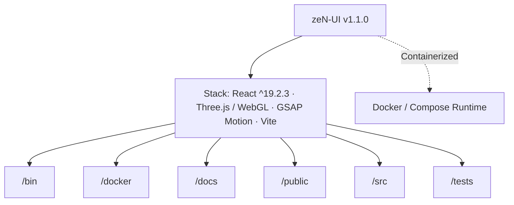

# zeN-UI // CAPRI Automated Architecture & AI Context Dossier
> Generated on demand via `npx capri docu` (Zero build or browser runtime overhead)

## 1. Project Identity & Stack Overview
- **Repository:** `zeN-UI` (`@zen-ui/system`)
- **Version:** `1.1.0`
- **Detected Stack:** React ^19.2.3 · Three.js / WebGL · GSAP Motion · Vite · @zen-ui/system (CAPRI) · TypeScript · Docker Containerized
- **Top-Level Subsystems:** `/bin`, `/docker`, `/docs`, `/public`, `/src`, `/tests`
- **Container Readiness:** `docker-compose.yml` present

## 2. Codebase Metrics & Language Breakdown
- **Total Source Files Scanned:** 46
- **Total Lines of Code (LOC):** 15,430
- **File Extensions:** `.tsx` (33), `.ts` (10), `.mjs` (1), `.html` (1), `.css` (1)
- **Key Exported Symbols / Classes / Functions (45):** `ZEN_ICON_SVG_INNER`, `StoryCategory`, `StoryControlType`, `StoryArgValue`, `StoryPropDef`, `StoryEntry`, `STORYBOOK_CATALOG`, `CATEGORY_FILTERS`, `buildInitialArgs`, `StorybookStageRenderer`, `SampleRow`, `StorybookStageRendererProps`, `ZenStorybookPlayground`, `CatalogSectionTab`, `InstallStackId`, `CATALOG_TABS`, `FRAMEWORK_OPTIONS`, `DEPLOY_REGION_OPTIONS`, `FILTER_CHIPS`, `INSTALL_STACK_SEGMENTS`, `INSTALL_SNIPPETS`, `AppShell`, `AppComponent`, `TokenSwatch`, `ComponentBenchmarkRow`, `TOKEN_SWATCHES`, `COMPONENT_BENCHMARKS`, `ORION_ACCORDION_ITEMS`, `WORKFLOW_STEPS`, `SHOWCASE_DOSSIERS`

## 3. Architecture & Subsystem Topology (`flowchart TD`)

## 4. Largest Modules & Entrypoints Inventory
| Module Path | Lines | Extension |
| :--- | ---: | :--- |
| `src/components/storybook/StorybookStageRenderer.tsx` | 1052 | `.tsx` |
| `src/lib/capri/capri-engine.ts` | 940 | `.ts` |
| `src/lib/cosmos/ZenCosmosCanvas.tsx` | 932 | `.tsx` |
| `src/sections/ComponentWorkbenchSection.tsx` | 920 | `.tsx` |
| `src/components/storybook/storybookCatalog.ts` | 903 | `.ts` |
| `src/lib/styles/zen-tokens.css` | 889 | `.css` |
| `bin/capri.mjs` | 805 | `.mjs` |
| `src/lib/universal/zen-universal.ts` | 744 | `.ts` |
| `src/App.tsx` | 687 | `.tsx` |
| `src/lib/components/ZenForms.tsx` | 665 | `.tsx` |
| `src/lib/components/ZenAIConstruct.tsx` | 595 | `.tsx` |
| `src/components/ZenStorybookPlayground.tsx` | 504 | `.tsx` |

## 6. Available Build & Automation Scripts
- `npm run dev`: `vite --port 5180`
- `npm run build`: `tsc --noEmit && vite build && npm run build:lib`
- `npm run build:lib`: `tsc -p tsconfig.lib.json && vite build --config vite.lib.config.ts`
- `npm run typecheck`: `tsc --noEmit`
- `npm run preview`: `vite preview --port 5180`
- `npm run test:e2e`: `playwright test`
- `npm run capri`: `node bin/capri.mjs`
- `npm run prepublishOnly`: `npm run capri -- all && npm run build`

## 7. Capri AI Agent Protocol (Claude / Codex / Gemini / Antigravity)
- **Subroutine `orion` (`CAPRI // UNLEASHED`):** Use `@zen-ui/system` primitives and `<ZenIcon>` (40 vector glyphs) for UI views; keep action labels concise (`1-3 words`).
- **Subroutine `architect` (`SCS // ARCHITECT`):** Enforce strict typing (zero `any`, `readonly T[]`), modular files (`< 900` lines), and `--zen-*` CSS tokens.
- **Subroutine `guard` (`CYBERPSYCHOSIS // GUARD`):** Sanitize untrusted inputs (`capri.sanitizeForPrompt()`), prevent XSS/secret leaks, bind dropdowns to `onMouseDown`, and ensure zero horizontal overflow (`320px` to `4K`).
- **Subroutine `zen` (`THEME // MATRIX`):** Maintain 4 Dark + 4 Light themes (`>= 4.5:1` AA contrast) and 60fps `--zen-ease-spring` tactile motion.
- **Subroutine `docu` (`CAPRI // AUTO-DOCU`):** Re-run `npx capri docu --write` whenever architectural boundaries or modules change.
